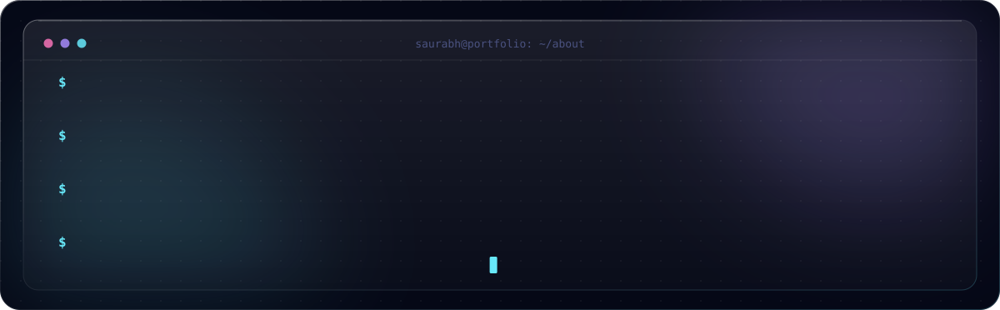
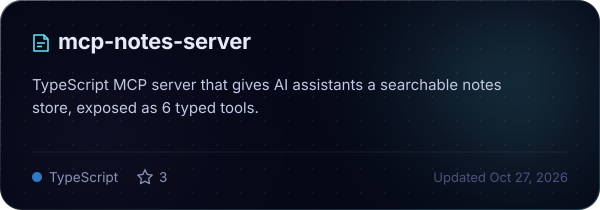
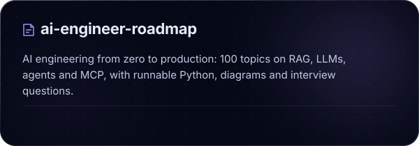

  

I build **AI agents that act on real systems**: MCP servers that give assistants tools, RAG pipelines that are measured with evals rather than guessed, and the production web apps around them. I also write about it at [mernstackdev.com](https://mernstackdev.com) for **10K+ developers a month**.

## About me

## Right now

  

## How I build AI systems

## Featured projects

  
  

## Activity

  
  

## Open-source contributions

<!-- OSS:START -->
<table align="center">
<tr><th>Project</th><th>Pull request</th><th>Merged</th></tr>
<tr><td><a href="https://github.com/makecindy/cindy"><b>makecindy/cindy</b></a></td><td><a href="https://github.com/makecindy/cindy/pull/7141">fix(desktop): 本地库 DB_INIT_FAILED 不再误导用户更新，且插件绑定刷新失败不阻断就绪</a></td><td>Nov 1, 2026</td></tr>
<tr><td><a href="https://github.com/makecindy/cindy"><b>makecindy/cindy</b></a></td><td><a href="https://github.com/makecindy/cindy/pull/8306">fix(desktop): 例行/渠道专线会话可通过 sessions.setStatus 归档 (#8299)</a></td><td>Nov 1, 2026</td></tr>
<tr><td><a href="https://github.com/makecindy/cindy"><b>makecindy/cindy</b></a></td><td><a href="https://github.com/makecindy/cindy/pull/7192">fix(cross-agent-convert): 修正 Codex hooks 双向转换的顶层结构并避免重复提示</a></td><td>Oct 27, 2026</td></tr>
<tr><td><a href="https://github.com/makecindy/cindy"><b>makecindy/cindy</b></a></td><td><a href="https://github.com/makecindy/cindy/pull/8014">fix(forge): 拆分 Agent 手册 §4.11.3 为独立章节，解除 4.11 章超 32 KiB 上限</a></td><td>Oct 30, 2026</td></tr>
<tr><td><a href="https://github.com/makecindy/cindy"><b>makecindy/cindy</b></a></td><td><a href="https://github.com/makecindy/cindy/pull/7634">fix(desktop): 用户显式配置的 ENABLE_TOOL_SEARCH 不再被 Cindy 默认值覆盖</a></td><td>Oct 29, 2026</td></tr>
<tr><td><a href="https://github.com/makecindy/cindy"><b>makecindy/cindy</b></a></td><td><a href="https://github.com/makecindy/cindy/pull/8104">feat(voice-input): 语音输入识别语言新增西班牙语</a></td><td>Oct 30, 2026</td></tr>
<tr><td><a href="https://github.com/makecindy/cindy"><b>makecindy/cindy</b></a></td><td><a href="https://github.com/makecindy/cindy/pull/8101">fix(desktop): 代理鉴权下 worker 准备失败只关闭该 worker,不再关停整个受管浏览器</a></td><td>Oct 31, 2026</td></tr>
</table>
<!-- OSS:END -->

## Skills

## Tech stack

<table>
<tr>
<td width="22%"><b>AI and agents</b></td>
<td>

 
</td>
</tr>
<tr>
<td><b>Languages</b></td>
<td></td>
</tr>
<tr>
<td><b>Frontend</b></td>
<td></td>
</tr>
<tr>
<td><b>Backend and data</b></td>
<td></td>
</tr>
<tr>
<td><b>Cloud and DevOps</b></td>
<td></td>
</tr>
<tr>
<td><b>Tools</b></td>
<td></td>
</tr>
</table>

## Latest from the blog

<!-- BLOG-POSTS:START -->
- [Bo2bot Messaging Built for AI Agents](https://mernstackdev.com/bo2bot-messaging-built-for-ai-agents/) Aug 11, 2026
- [MySQL JSON Functions for Dynamic Data](https://mernstackdev.com/mysql-json-functions-for-dynamic-data/) Jul 16, 2026
- [Using Streams in Node JS](https://mernstackdev.com/using-streams-in-node-js/) Jul 16, 2026
- [Revolutionizing React Server Components](https://mernstackdev.com/revolutionizing-react-server-components/) Jul 16, 2026
- [Express Applications to Version 5](https://mernstackdev.com/express-applications-to-version-5/) Jul 16, 2026
<!-- BLOG-POSTS:END -->

[Read more on mernstackdev.com](https://mernstackdev.com)

## Contribution snake

  

  If my repos or the roadmap helped you, a ⭐ helps others find them.  
  

  

  <b>Saurabh Pathak</b> &nbsp;|&nbsp; <a href="mailto:saurabhpathak394@gmail.com">saurabhpathak394@gmail.com</a>

