  

  
  
  
  
  
  

I build **AI-agent tooling and production web apps**, and write about it for 10K+ developers a month. Open to **AI Engineer** and **Full-Stack** roles.

## 🚀 Featured projects
| Project | What it does | Stack |
|---|---|---|
| [**ai-engineer-roadmap**](https://github.com/techsaurabh-394/ai-engineer-roadmap)  | Step-by-step roadmap: LLMs, RAG, agents, MCP, evaluation, production, 47 interview questions. Runnable code, animated diagrams, CI | Python, TypeScript |
| [**mcp-notes-server**](https://github.com/techsaurabh-394/mcp-notes-server)  | MCP server that gives AI assistants a searchable notes memory (4 typed tools, Claude Desktop ready) | TypeScript, MCP |
| [**rag-docs-chat**](https://github.com/techsaurabh-394/rag-docs-chat)  | Chat with PDFs; every answer cites page and passage; includes a retrieval eval script | Python, FastAPI, RAG |
| [**claude-skills**](https://github.com/techsaurabh-394/claude-skills)  | Reusable Claude Skills for SEO/GEO audits, technical blogging and MCP servers | Claude Skills |

## ✍️ Latest from the blog
<!-- BLOG-POSTS:START -->
- [Bo2bot: Messaging Built: Complete Guide 2024 | Tutorials & Examples](https://mernstackdev.com/bo2bot-messaging-built-for-ai-agents/) · Aug 11, 2026
- [How to Use: Complete Guide 2024 | Tutorials & Examples](https://mernstackdev.com/mysql-json-functions-for-dynamic-data/) · Jul 16, 2026
- [Using Streams in: Complete Guide 2024 | Tutorials & Examples](https://mernstackdev.com/using-streams-in-node-js/) · Jul 16, 2026
- [Revolutionizing React: The: Complete Guide 2024 | Tutorials & Examples](https://mernstackdev.com/revolutionizing-react-server-components/) · Jul 16, 2026
- [Migrating Your Existing: Complete Guide 2024 | Tutorials & Examples](https://mernstackdev.com/express-applications-to-version-5/) · Jul 16, 2026
<!-- BLOG-POSTS:END -->

## 🔭 Working on
- 🤖 AI agents and MCP: tools that let LLMs act on real systems
- 🔎 RAG pipelines with retrieval evaluation
- 🌐 Full-stack products shipped end to end (Next.js, Node.js, Docker, CI/CD)

## 💻 Tech stack
          

## 📈 Activity

  
  

## ☕ Support my open-source work
If my repos or the roadmap helped you, you can [buy me a coffee](https://buymeacoffee.com/saurabhdev) and a ⭐ helps others find them.

## 📫 Reach me
**Saurabh Pathak** · saurabhpathak394@gmail.com · [LinkedIn](https://www.linkedin.com/in/tech-saurabh/) · [GitHub](https://github.com/techsaurabh-394) · [Blog](https://mernstackdev.com)
