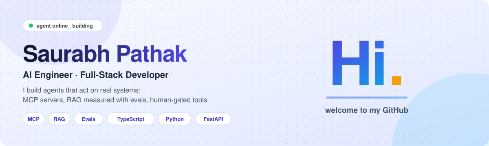
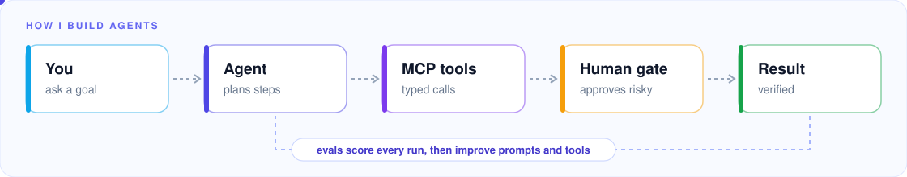
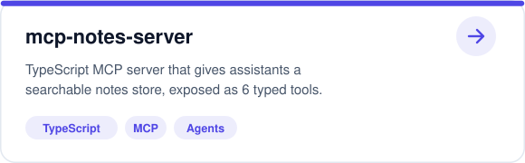
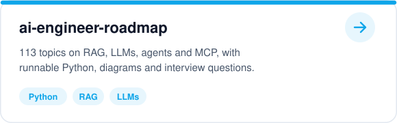
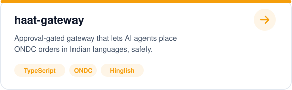
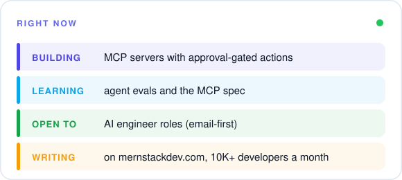
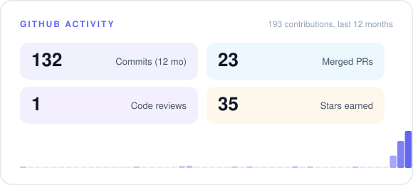
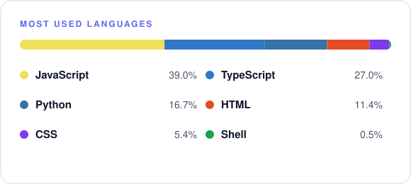
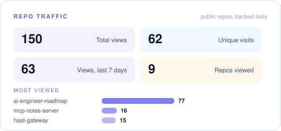
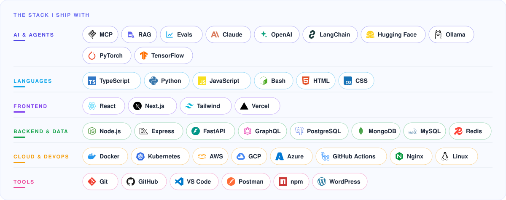

  

 

## 🤖 How I build agents

 

## 🚀 Featured projects

  
  

  

## 📊 Right now and by the numbers

  
  

  
  

  

## 🧰 Tech stack

## 🤝 Open-source contributions

<!-- OSS:START -->
- [FlashML-org/FreeToken](https://github.com/FlashML-org/FreeToken): [fix(server): reject empty completions prompt and keep error code](https://github.com/FlashML-org/FreeToken/pull/850) Nov 7, 2026
- [makecindy/cindy](https://github.com/makecindy/cindy): [fix(desktop): 本地库 DB_INIT_FAILED 不再误导用户更新，且插件绑定刷新失败不阻断就绪](https://github.com/makecindy/cindy/pull/7141) Nov 1, 2026
- [makecindy/cindy](https://github.com/makecindy/cindy): [fix(desktop): 例行/渠道专线会话可通过 sessions.setStatus 归档 (#8299)](https://github.com/makecindy/cindy/pull/8306) Nov 1, 2026
- [makecindy/cindy](https://github.com/makecindy/cindy): [fix(cross-agent-convert): 修正 Codex hooks 双向转换的顶层结构并避免重复提示](https://github.com/makecindy/cindy/pull/7192) Oct 27, 2026
- [makecindy/cindy](https://github.com/makecindy/cindy): [fix(forge): 拆分 Agent 手册 §4.11.3 为独立章节，解除 4.11 章超 32 KiB 上限](https://github.com/makecindy/cindy/pull/8014) Oct 30, 2026
<!-- OSS:END -->

## ✍️ Latest writing

<!-- BLOG-POSTS:START -->
- [Zod vs Joi vs Yup: Which Validation Library Should You Use?](https://mernstackdev.com/zod-vs-joi-vs-yup/) Nov 11, 2026
- [Fix MongooseServerSelectionError: connect ECONNREFUSED 127.0.0.1:27017](https://mernstackdev.com/mongoose-server-selection-error-econnrefused/) Nov 11, 2026
- [Mongoose Schema Types Explained With Examples](https://mernstackdev.com/mongoose-schema-types/) Nov 11, 2026
- [Fix MongoDB E11000 Duplicate Key Error (Mongoose Guide)](https://mernstackdev.com/mongodb-e11000-duplicate-key-error/) Nov 11, 2026
- [MongoDB Aggregation for SQL Developers: GROUP BY, JOIN and More](https://mernstackdev.com/mongodb-aggregation-for-sql-developers/) Nov 11, 2026
<!-- BLOG-POSTS:END -->

[More on mernstackdev.com →](https://mernstackdev.com)

 

 

If my repos or the roadmap helped you, a ⭐ helps others find them.

